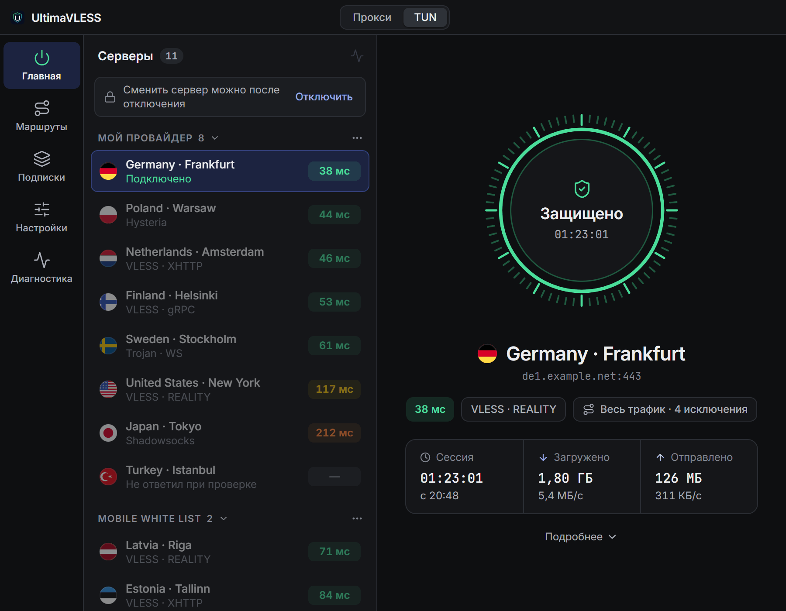
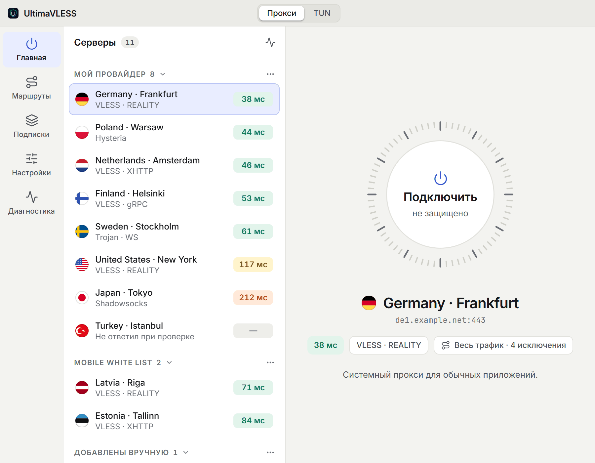
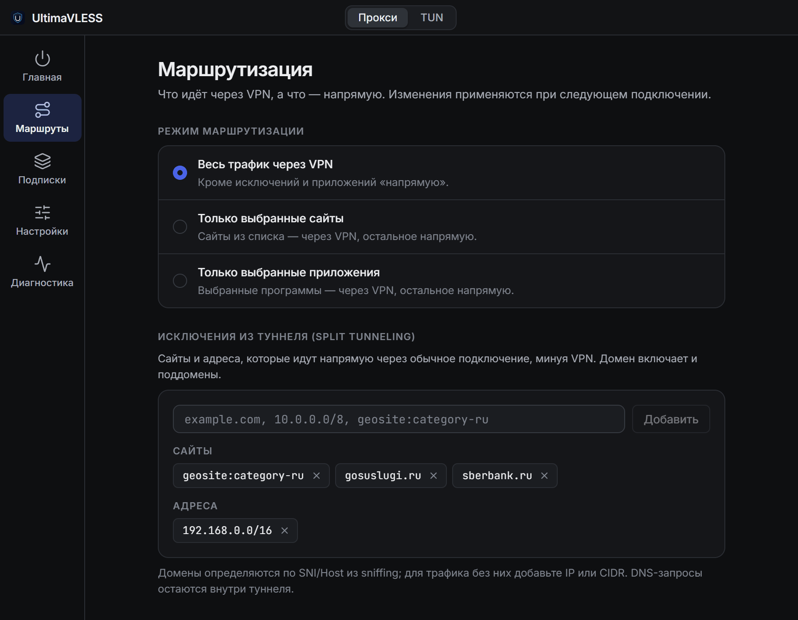
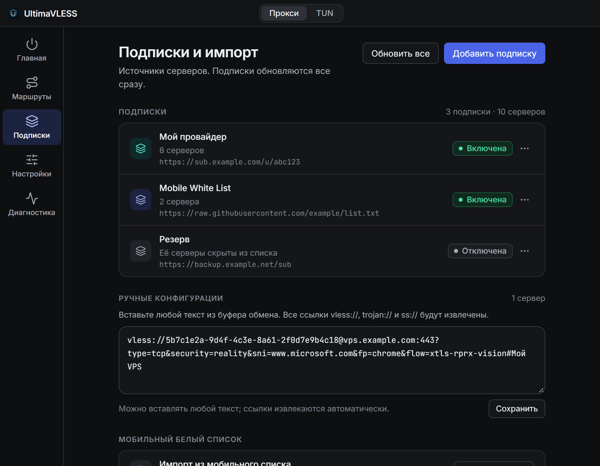
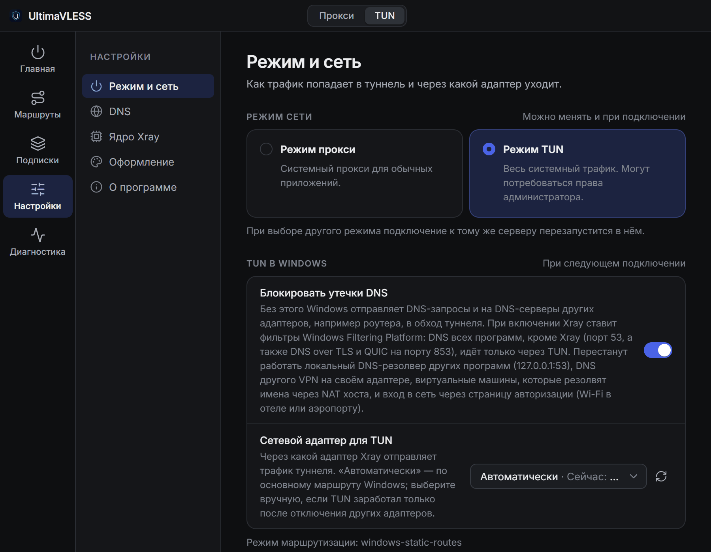
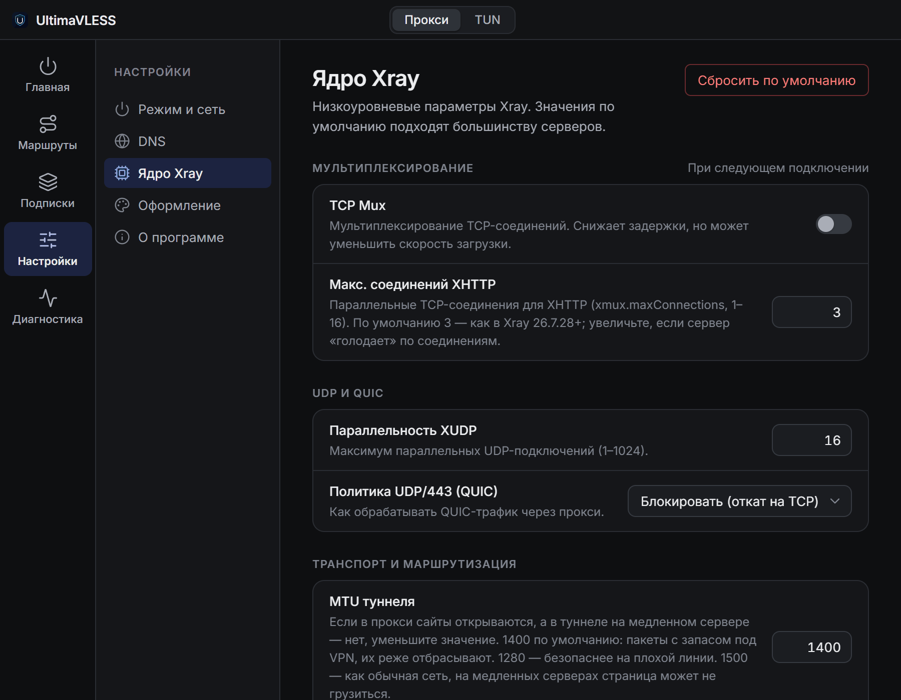
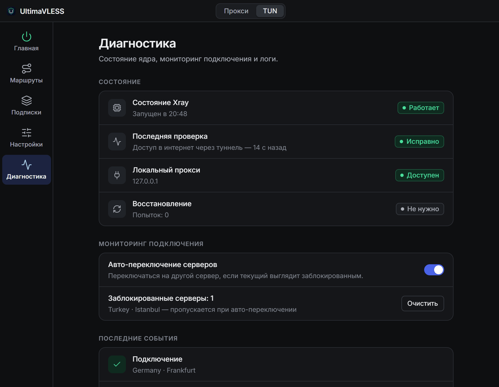
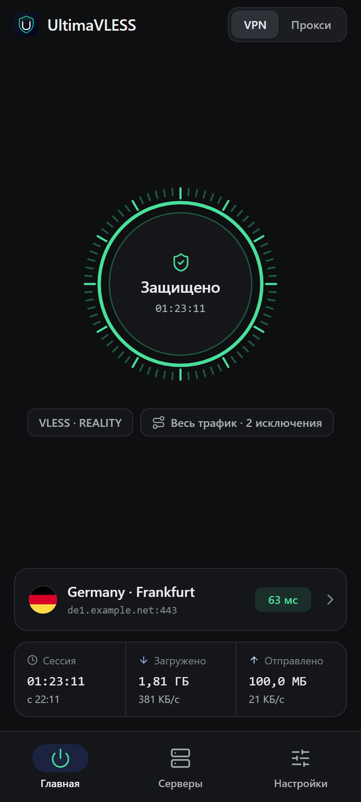
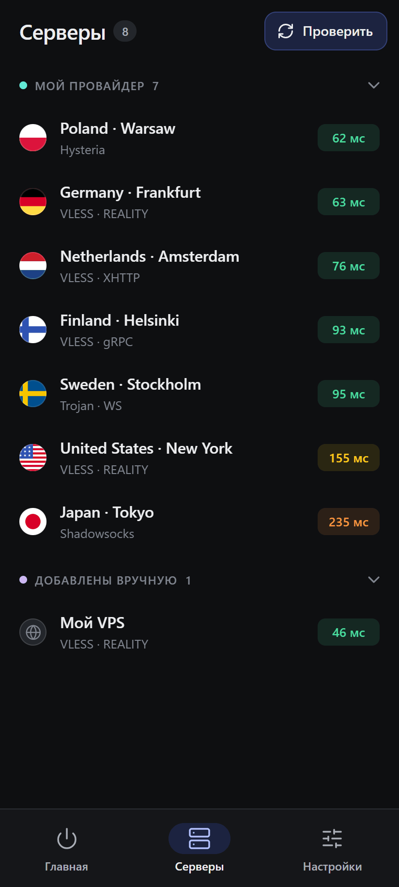
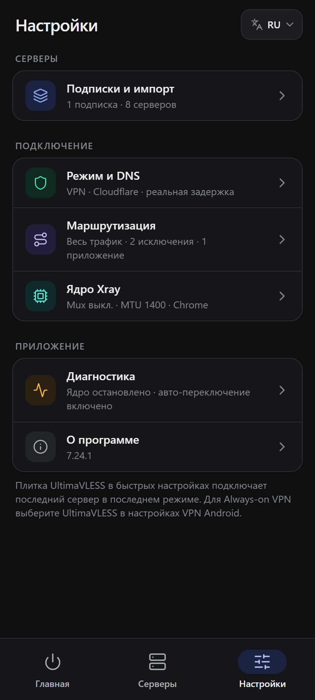

# Ultima VLESS Client

*Язык / Language*:

[](README.md)
[](README_EN.md)

---

[](https://github.com/sliva-name/ultimaVLESS/stargazers)
[](https://github.com/sliva-name/ultimaVLESS/releases)
[](https://hits.sh/github.com/sliva-name/ultimaVLESS/)

**Ultima VLESS Client** — бесплатный VPN-клиент с открытым исходным кодом на ядре Xray-core для **Windows, macOS, Linux и Android**. Принимает подписки и ссылки `vless://`, `trojan://`, `ss://`, `hy2://`, честно проверяет серверы реальной задержкой, работает через системный прокси или TUN и умеет пускать через VPN только нужные сайты и приложения.

Основная платформа — **Windows**. На macOS и Linux часть функций работает иначе или ограничена — см. [Режимы подключения](#режимы-подключения).

<p align="center">
  
</p>

Сайт проекта: [sliva-name.github.io/ultimaVLESS](https://sliva-name.github.io/ultimaVLESS/)

## Скачать

Все файлы — в [последнем релизе](https://github.com/sliva-name/ultimaVLESS/releases/latest).

| Система | Какой файл скачать |
| --- | --- |
| **Windows 10/11** (x64) | `UltimaVLESS-Setup-<версия>.exe` — установщик, обновляется сам. `UltimaVLESS-Portable-<версия>.exe` — без установки, обновлять вручную |
| **macOS** | Apple Silicon (M1 и новее): `UltimaVLESS-<версия>-arm64.dmg`. Intel: `UltimaVLESS-<версия>.dmg`. Есть те же сборки в `.zip` |
| **Linux** (x64) | `UltimaVLESS-<версия>.AppImage` или `ultima-vless-client_<версия>_amd64.deb` |
| **Android 7.0+** | `UltimaVLESS-Android-<версия>-arm64-v8a.apk` — для большинства телефонов. Если не уверены — `-universal.apk` |

Контрольные суммы лежат там же: `SHA256SUMS-windows.txt`, `-macos.txt`, `-linux.txt`, `-android.txt`.

> [!NOTE]
> Сборки не подписаны платными сертификатами. **Windows** может показать «Windows защитил ваш компьютер» — нажмите «Подробнее» → «Выполнить в любом случае». **macOS** может не открыть программу или назвать её повреждённой — разрешите запуск в «Системные настройки → Конфиденциальность и безопасность» или снимите карантин командой `xattr -dr com.apple.quarantine /Applications/UltimaVLESS.app`.

## Быстрый старт

1. Установите и откройте **UltimaVLESS**.
2. Добавьте серверы — при первом запуске поля для этого есть прямо на главной, позже они в разделе **«Подписки»**:
   - **подписка** — ссылка `https://…` от провайдера;
   - **ссылки вручную** — вставьте любой текст: ссылки `vless://`, `trojan://`, `ss://`, `hy2://` найдутся в нём сами;
   - **нет своих серверов** — нажмите «Импорт мобильного списка».
3. Выберите сервер в списке. Кнопка с графиком над списком проверяет задержку всех серверов.
4. Вверху окна выберите режим — **Прокси** или **TUN**.
5. Нажмите на кольцо **«Подключить»**.

Режим можно переключать и во время подключения — клиент переподключится к тому же серверу. Чтобы сменить сервер, сначала отключитесь.

## Возможности

**Серверы и подписки**
- Подписки по HTTPS: текст, Base64 или JSON-конфиги Xray. Их можно отключать, не удаляя, и обновлять все разом; клиент и сам обновляет их каждые 10 минут.
- Если сайт подписки недоступен (например, при белых списках), подписку можно загружать **через Яндекс Переводчик**.
- Ссылки вручную — вставляется любой текст, лишнее отбрасывается.
- Серверы сгруппированы по подпискам, у каждого — флаг страны, протокол и транспорт.

**Подключение**
- Два режима: **Прокси** (системный прокси) и **TUN** (весь трафик системы через виртуальный адаптер).
- Подключение проходит этапы «запуск ядра → проверка туннеля → защищено»: клиент проверяет, что через туннель действительно есть интернет.
- Статистика сессии: время, загружено и отправлено, текущая скорость.
- **Автопереключение**: если текущий сервер перестал пропускать трафик, клиент сам переходит на другой и восстанавливает соединение.

**Проверка серверов**
- По умолчанию — **реальная задержка**: для каждого сервера запускается временный Xray и через него отправляется HTTP-запрос, как в v2rayN. Сервер, который отвечает, но не пропускает трафик, не выглядит рабочим.
- Быстрый **TCP-пинг** — только доступность, включается в «Настройки → Режим и сеть».
- Проверка всех серверов или одной подписки, проверку можно остановить.

**Маршрутизация (split tunneling)** — раздел **«Маршруты»**, подробно в [docs/routing-rules.md](docs/routing-rules.md)
- Три режима: весь трафик через VPN с исключениями, только выбранные сайты или только выбранные приложения.
- Сайты и адреса: домены, IP, подсети, списки `geosite:` и `geoip:`.
- Приложения через VPN или всегда напрямую — программу можно выбрать из списка запущенных.
- Блокировка рекламы и BitTorrent.

**Сеть, DNS и ядро**
- Удалённый DNS: Cloudflare, Google, Quad9 или свой; отдельная стратегия DNS для TUN (IPv4 / IPv6).
- Windows: блокировка утечек DNS в TUN и выбор сетевого адаптера, через который уходит туннель.
- Тонкая настройка Xray: Mux, XUDP, политика QUIC (UDP/443), соединения XHTTP, MTU туннеля, TCP Fast Open, sniffing, TLS-отпечаток, стратегия доменов, уровень логов.

**Диагностика**
- Состояние Xray, последняя проверка туннеля, доступность локального прокси, восстановление соединения.
- Список заблокированных серверов, которые автопереключение пропускает, и последние события.
- Windows: поиск других VPN, прокси-клиентов и программ обхода DPI, которые мешают TUN, — их можно закрыть из окна клиента.
- Логи: скопировать (личные данные из них вырезаются) или открыть папку.

**Интерфейс**
- Тёмная и светлая тема или как в системе.
- Шесть языков: русский, английский, китайский, персидский, испанский и турецкий.
- Иконка в трее и автообновление через GitHub.

## Скриншоты

| Светлая тема | Маршруты |
| --- | --- |
|  |  |
| **Подписки** | **Настройки** |
|  |  |
| **Ядро Xray** | **Диагностика** |
|  |  |

## Поддерживаемые протоколы

| Протокол | Как добавить |
| --- | --- |
| **VLESS** (в том числе REALITY, Vision, XHTTP) | Ссылка `vless://`, текстовая или JSON-подписка |
| **Trojan** | Ссылка `trojan://`, текстовая или JSON-подписка |
| **Shadowsocks** | Ссылка `ss://`, текстовая или JSON-подписка |
| **Hysteria 2** | Ссылка `hy2://` / `hysteria2://` или JSON-подписка |
| **WireGuard** | Только JSON-подписка (готовый outbound Xray) |
| **VMess** | Только JSON-подписка (готовый конфиг Xray) |

Транспорты: RAW (TCP), XHTTP, WebSocket, gRPC, HTTPUpgrade, mKCP. REALITY и Vision — не отдельные протоколы, а варианты настройки VLESS.

**Не поддерживаются:** TUIC, ссылки `vmess://`, протоколы вне Xray и зашифрованные ссылки Happ (`happ://crypt…`) — их может открыть только приложение Happ; попросите у провайдера обычную ссылку `https://`.

## Режимы подключения

**Прокси** — подходит большинству. Не требует прав администратора: клиент включает системный прокси и возвращает прежние настройки при отключении. Браузеры и большинство программ подхватывают его сами. Программам, которые не смотрят на системный прокси, можно указать локальные SOCKS5 `127.0.0.1:10808` или HTTP `127.0.0.1:10809`.

**TUN** — перехватывает весь сетевой трафик через виртуальный адаптер, включая программы без поддержки прокси.
- **Windows** — при подключении появится запрос UAC.
- **Linux** — нужен агент PolicyKit (`pkexec`), чтобы клиент запросил права, или запуск от root.
- **macOS** — режим TUN недоступен, используйте прокси.

## Где что находится

| Раздел | Что там |
| --- | --- |
| **Главная** | Список серверов, проверка задержки, кнопка подключения, статистика сессии |
| **Маршруты** | Режим маршрутизации, сайты и приложения через VPN или напрямую, блокировка рекламы и BitTorrent |
| **Подписки** | Подписки, ручные ссылки, импорт мобильного белого списка |
| **Настройки → Режим и сеть** | Прокси / TUN, блокировка утечек DNS и адаптер для TUN (Windows), способ проверки задержки |
| **Настройки → DNS** | Удалённый DNS, DNS в режиме TUN |
| **Настройки → Ядро Xray** | Mux, UDP и QUIC, XHTTP, MTU, TLS-отпечаток, логи |
| **Настройки → Оформление** | Тема и язык |
| **Настройки → О программе** | Версия, обновления, исходный код |
| **Диагностика** | Состояние ядра, автопереключение, события, другие VPN, логи |

Изменения в «Маршрутах» и «Настройках» сохраняются кнопкой **«Сохранить»** внизу и применяются при следующем подключении. Пока VPN подключён, эти разделы закрыты для правки — тему, язык и режим подключения можно менять в любой момент.

## Встроенный бесплатный список

Если своих серверов нет, можно одним нажатием добавить публичный список серверов (Mobile White List) как подписку: кнопка **«Импорт мобильного списка»** на пустой главной или **«Подписки» → «Мобильный белый список» → «Открыть превью»** — список заодно откроется в браузере.

## Если что-то не работает

| Проблема | Что попробовать |
| --- | --- |
| TUN просит права администратора | Это нормально для Windows — подтвердите UAC или переключитесь на **Прокси**. На Linux установите агент PolicyKit (`pkexec`) |
| TUN не поднимается, пока не отключишь лишние сетевые адаптеры (Windows) | **Настройки → Режим и сеть → «Сетевой адаптер для TUN»** — выберите адаптер, через который реально идёт интернет (обычно Wi-Fi или основной Ethernet), сохраните и переподключитесь |
| Запущен другой VPN, прокси-клиент или обход DPI (Windows) | Клиент покажет такие программы при подключении в TUN и в **«Диагностика» → «Другие VPN и прокси»** — закройте их кнопкой **«Закрыть»** и переподключитесь. Службы (WireGuard, NordVPN и т. п.) не закрываются автоматически — отключите VPN в самой программе |
| В режиме прокси сайты открываются, а в TUN на медленном сервере — нет | Уменьшите **MTU туннеля** в «Настройки → Ядро Xray» (например, до 1280) |
| Подписка не загружается | Проверьте ссылку в браузере и интернет. Если сайт подписки заблокирован, включите **«Загружать через Яндекс Переводчик»** при добавлении — только для публичных списков: Яндекс увидит ссылку и серверы |
| «Это зашифрованная ссылка Happ» | Такую ссылку открывает только Happ — попросите у провайдера обычную ссылку `https://` |
| У сервера нет задержки | Реальная задержка не прошла: через сервер сейчас не идёт трафик (сервер не работает или его блокирует провайдер). Выберите сервер с задержкой |
| Нужна помощь | **«Диагностика» → «Логи»** — скопируйте логи и приложите к [issue](https://github.com/sliva-name/ultimaVLESS/issues) |

## Android

<p align="center">
  
  &nbsp;
  
  &nbsp;
  
</p>

Версия для Android — тот же клиент: подписки, ручные ссылки, реальная задержка, автопереключение, правила маршрутизации и тонкая настройка Xray. APK — в [релизах](https://github.com/sliva-name/ultimaVLESS/releases/latest), обновления приходят прямо в приложении: новая версия скачивается в фоне и ставится через системный установщик.

Чем отличается от десктопа:
- Режим **VPN** вместо TUN — системный `VpnService`, разрешение Android спросит при первом подключении.
- Режим **«Только прокси»** — без VPN, локальные SOCKS5 `127.0.0.1:10808` и HTTP `127.0.0.1:10809` для приложений, где прокси настраивается вручную.
- Приложения для маршрутизации выбираются из установленных (по имени пакета).
- Уведомление с сервером, режимом, скоростью и кнопкой «Отключить», плитка в быстрых настройках и поддержка Always-on VPN.

Как устроена и собирается мобильная версия — в [mobile/README.md](mobile/README.md).

## Сборка из исходников

Нужен Node.js 22.

```bash
npm ci
```

```bash
npm run prepare:xray:win
```

```bash
npm run dev
```

`prepare:xray:*` скачивает Xray-core и `geoip.dat` / `geosite.dat` в `resources/bin` (для macOS и Linux — `prepare:xray:mac` и `prepare:xray:linux`). `npm run dev` запускает клиент в режиме разработки. Сборка установщиков — `npm run build` (Windows), `npm run build:mac`, `npm run build:linux`, результат — в `release/<версия>/`. Проверки, как в CI: `npm run verify:ci`.

## Лицензия

MIT — программа распространяется бесплатно и с открытым исходным кодом.
