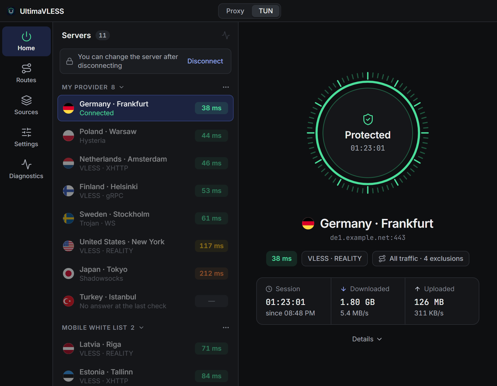
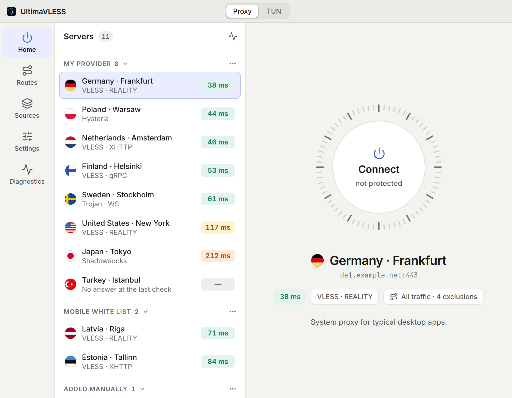
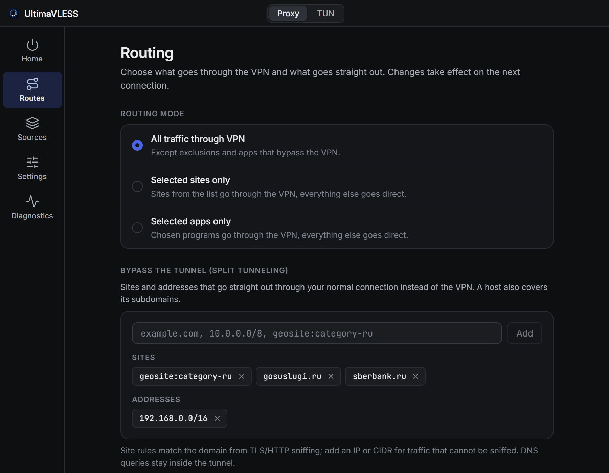
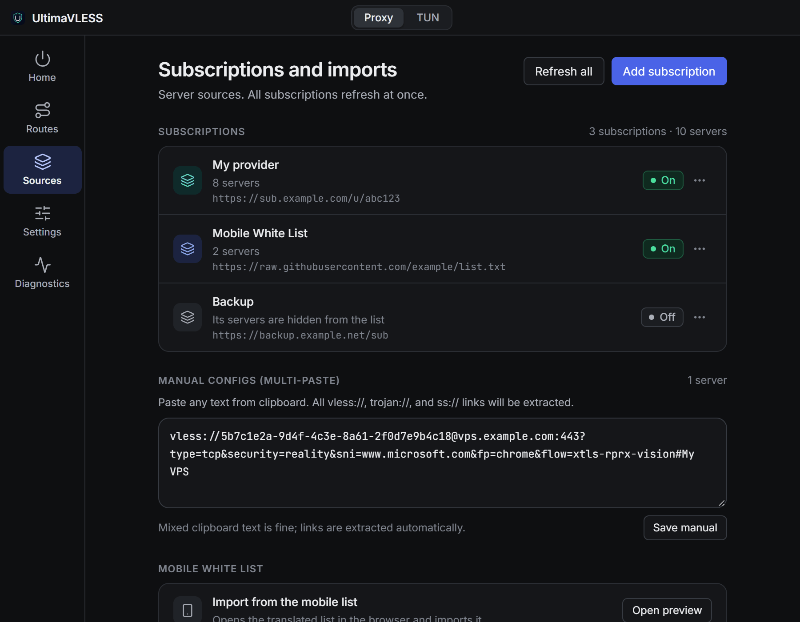
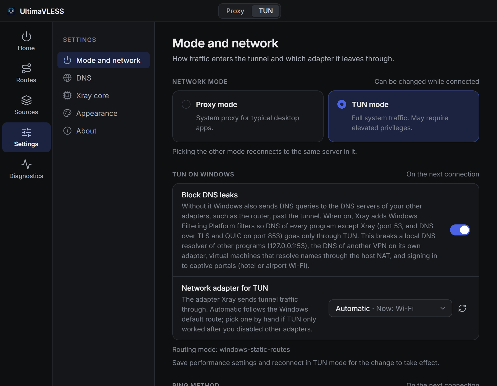
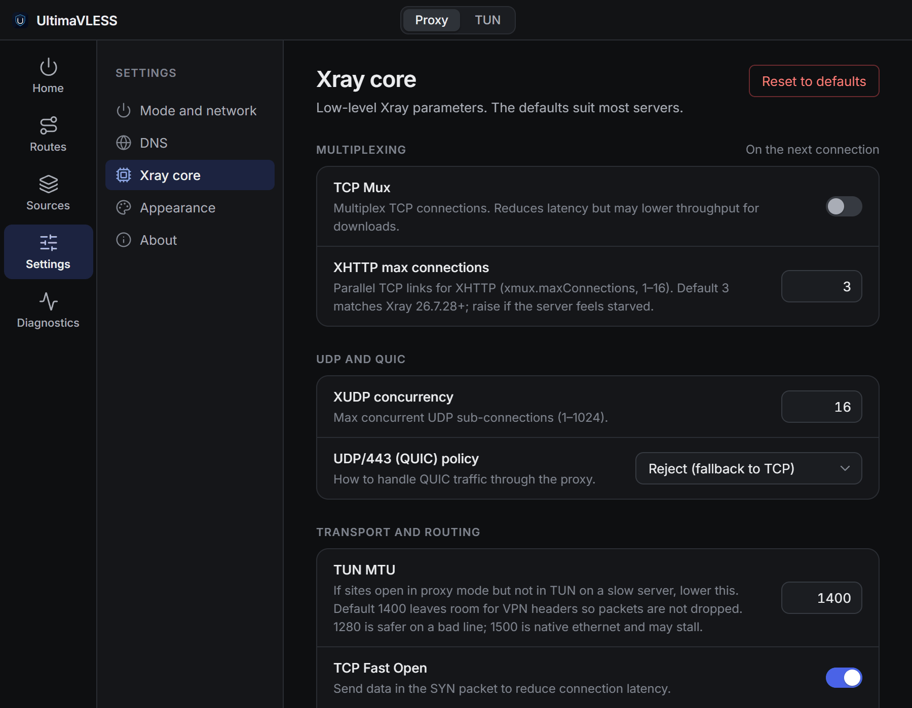
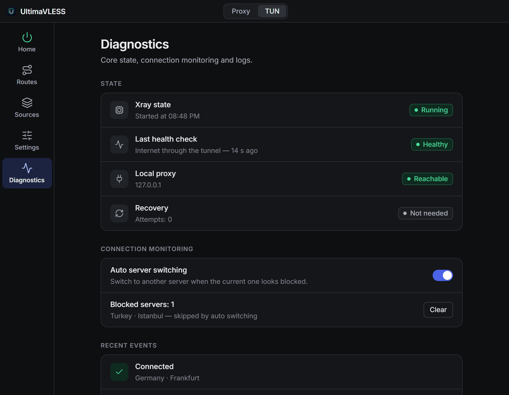
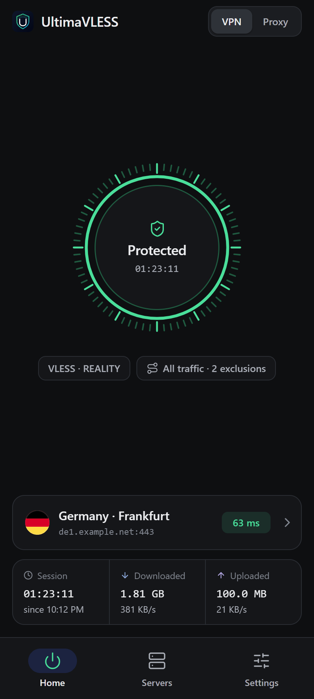
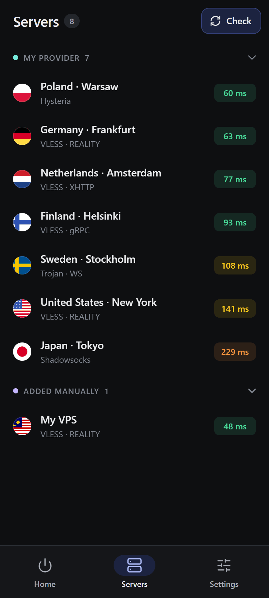
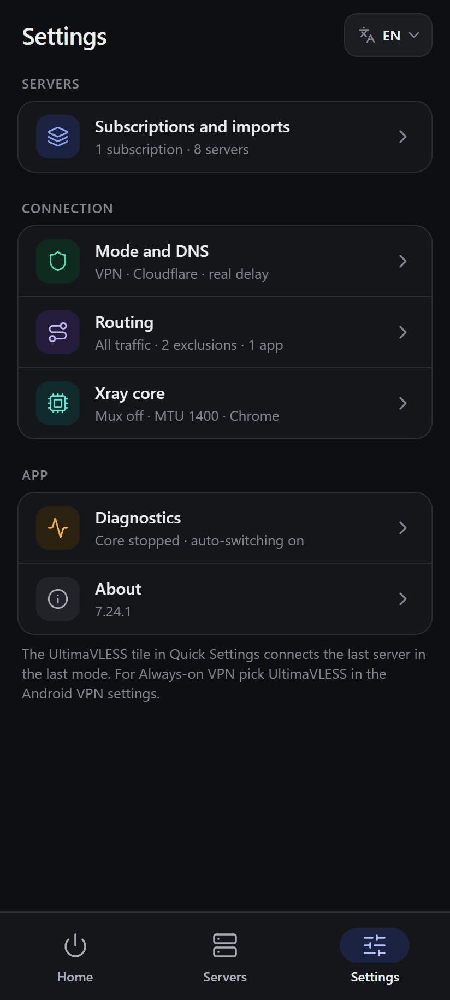

# Ultima VLESS Client

*Language / Язык*:

[](README.md)
[](README_EN.md)

---

[](https://github.com/sliva-name/ultimaVLESS/stargazers)
[](https://github.com/sliva-name/ultimaVLESS/releases)
[](https://hits.sh/github.com/sliva-name/ultimaVLESS/)

**Ultima VLESS Client** is a free, open-source VPN client built on Xray-core for **Windows, macOS, Linux and Android**. It takes subscriptions and `vless://`, `trojan://`, `ss://`, `hy2://` links, checks servers by real delay, works through the system proxy or TUN, and can send only the sites and apps you choose through the VPN.

The primary platform is **Windows**. On macOS and Linux some features work differently or are limited — see [Connection modes](#connection-modes).

<p align="center">
  
</p>

Project website: [sliva-name.github.io/ultimaVLESS](https://sliva-name.github.io/ultimaVLESS/)

## Download

All files are in the [latest release](https://github.com/sliva-name/ultimaVLESS/releases/latest).

| System | Which file to download |
| --- | --- |
| **Windows 10/11** (x64) | `UltimaVLESS-Setup-<version>.exe` — installer, updates itself. `UltimaVLESS-Portable-<version>.exe` — no install, update by hand |
| **macOS** | Apple Silicon (M1 and later): `UltimaVLESS-<version>-arm64.dmg`. Intel: `UltimaVLESS-<version>.dmg`. The same builds also come as `.zip` |
| **Linux** (x64) | `UltimaVLESS-<version>.AppImage` or `ultima-vless-client_<version>_amd64.deb` |
| **Android 7.0+** | `UltimaVLESS-Android-<version>-arm64-v8a.apk` — for most phones. If unsure, take `-universal.apk` |

Checksums are next to them: `SHA256SUMS-windows.txt`, `-macos.txt`, `-linux.txt`, `-android.txt`.

> [!NOTE]
> The builds are not signed with paid certificates. **Windows** may show "Windows protected your PC" — click "More info" → "Run anyway". **macOS** may refuse to open the app or call it damaged — allow it in "System Settings → Privacy & Security" or remove the quarantine flag with `xattr -dr com.apple.quarantine /Applications/UltimaVLESS.app`.

## Quick start

1. Install and open **UltimaVLESS**.
2. Add servers — on first launch the fields are right on the home screen, later they live in **Sources**:
   - **subscription** — an `https://…` link from your provider;
   - **links by hand** — paste any text: `vless://`, `trojan://`, `ss://`, `hy2://` links are picked out of it;
   - **no servers of your own** — click "Import the mobile list".
3. Pick a server in the list. The chart button above the list checks the latency of all servers.
4. Choose the mode at the top of the window — **Proxy** or **TUN**.
5. Click the **Connect** ring.

The mode can be switched while connected — the client reconnects to the same server in it. To change the server, disconnect first.

## Features

**Servers and subscriptions**
- HTTPS subscriptions: plain text, Base64 or Xray JSON configs. Turn them off without deleting, refresh them all at once; the client also refreshes them every 10 minutes.
- If the subscription site is unreachable (for example, under whitelist blocking), a subscription can be fetched **through Yandex Translate**.
- Links by hand — paste any text, everything else is dropped.
- Servers are grouped by subscription, each with a country flag, protocol and transport.

**Connection**
- Two modes: **Proxy** (system proxy) and **TUN** (all system traffic through a virtual adapter).
- Connecting goes through "core start → tunnel check → protected": the client verifies that the tunnel actually reaches the internet.
- Session statistics: duration, downloaded and uploaded, current speed.
- **Auto switching**: if the current server stops passing traffic, the client moves to another one and restores the connection.

**Server checks**
- **Real delay** by default: each server gets a temporary Xray and an HTTP request goes through it, like in v2rayN. A server that answers but passes no traffic does not look alive.
- Fast **TCP ping** — reachability only, under "Settings → Mode and network".
- Check all servers or one subscription; a check can be stopped.

**Routing (split tunneling)** — the **Routes** section, details in [docs/routing-rules.md](docs/routing-rules.md) (Russian)
- Three modes: all traffic through the VPN with exceptions, selected sites only, or selected apps only.
- Sites and addresses: domains, IPs, subnets, `geosite:` and `geoip:` lists.
- Apps through the VPN or always direct — pick a program from the list of running ones.
- Ad and BitTorrent blocking.

**Network, DNS and core**
- Remote DNS: Cloudflare, Google, Quad9 or your own; a separate DNS strategy for TUN (IPv4 / IPv6).
- Windows: DNS leak blocking in TUN and a choice of the network adapter the tunnel goes out through.
- Xray tuning: Mux, XUDP, QUIC (UDP/443) policy, XHTTP connections, TUN MTU, TCP Fast Open, sniffing, TLS fingerprint, domain strategy, log level.

**Diagnostics**
- Xray state, the last tunnel check, local proxy reachability, connection recovery.
- Blocked servers that auto switching skips, and recent events.
- Windows: finds other VPNs, proxy clients and DPI bypass tools that break TUN — and closes them from the client.
- Logs: copy them (personal data is stripped) or open the folder.

**Interface**
- Dark and light themes, or follow the system.
- Six languages: Russian, English, Chinese, Persian, Spanish and Turkish.
- Tray icon and auto-updates from GitHub.

## Screenshots

| Light theme | Routes |
| --- | --- |
|  |  |
| **Sources** | **Settings** |
|  |  |
| **Xray core** | **Diagnostics** |
|  |  |

## Supported protocols

| Protocol | How to add |
| --- | --- |
| **VLESS** (including REALITY, Vision, XHTTP) | `vless://` link, text or JSON subscription |
| **Trojan** | `trojan://` link, text or JSON subscription |
| **Shadowsocks** | `ss://` link, text or JSON subscription |
| **Hysteria 2** | `hy2://` / `hysteria2://` link or JSON subscription |
| **WireGuard** | JSON subscription only (a ready Xray outbound) |
| **VMess** | JSON subscription only (a ready Xray config) |

Transports: RAW (TCP), XHTTP, WebSocket, gRPC, HTTPUpgrade, mKCP. REALITY and Vision are not separate protocols but VLESS settings.

**Not supported:** TUIC, `vmess://` links, protocols outside Xray, and encrypted Happ links (`happ://crypt…`) — only the Happ app can open them; ask your provider for a regular `https://` link.

## Connection modes

**Proxy** — fits most people. No administrator rights needed: the client turns on the system proxy and restores the previous settings on disconnect. Browsers and most programs pick it up on their own. Programs that ignore the system proxy can use the local SOCKS5 `127.0.0.1:10808` or HTTP `127.0.0.1:10809`.

**TUN** — captures all network traffic through a virtual adapter, including programs without proxy support.
- **Windows** — a UAC prompt appears when connecting.
- **Linux** — needs a PolicyKit agent (`pkexec`) so the client can ask for rights, or running as root.
- **macOS** — TUN is not available, use Proxy.

## Where things are

| Section | What is there |
| --- | --- |
| **Home** | Server list, latency check, the connect button, session statistics |
| **Routes** | Routing mode, sites and apps through the VPN or direct, ad and BitTorrent blocking |
| **Sources** | Subscriptions, manual links, the mobile white list import |
| **Settings → Mode and network** | Proxy / TUN, DNS leak blocking and the TUN adapter (Windows), ping method |
| **Settings → DNS** | Remote DNS, DNS in TUN mode |
| **Settings → Xray core** | Mux, UDP and QUIC, XHTTP, MTU, TLS fingerprint, logs |
| **Settings → Appearance** | Theme and language |
| **Settings → About** | Version, updates, source code |
| **Diagnostics** | Core state, auto switching, events, other VPNs, logs |

Changes in **Routes** and **Settings** are saved with the **Save** button at the bottom and apply on the next connection. While the VPN is connected these sections are read-only — the theme, language and connection mode can be changed at any time.

## Built-in free list

If you have no servers of your own, a public server list (Mobile White List) can be added as a subscription in one click: **Import the mobile list** on the empty home screen, or **Sources → Mobile white list → Open preview** — the list also opens in the browser.

## Troubleshooting

| Problem | What to try |
| --- | --- |
| TUN asks for administrator rights | This is normal on Windows — confirm UAC or switch to **Proxy**. On Linux, install a PolicyKit agent (`pkexec`) |
| TUN only comes up after disabling extra network adapters (Windows) | **Settings → Mode and network → "Network adapter for TUN"** — pick the adapter your internet actually goes through (usually Wi-Fi or the main Ethernet), save and reconnect |
| Another VPN, proxy client or DPI bypass tool is running (Windows) | The client lists such programs when connecting in TUN and under **Diagnostics → "Other VPN and proxy apps"** — close them with **Close** and reconnect. Services (WireGuard, NordVPN, etc.) are not closed automatically — turn off the VPN in that program |
| Sites open in Proxy but not in TUN on a slow server | Lower the **TUN MTU** in "Settings → Xray core" (for example, to 1280) |
| A subscription does not load | Check the link in a browser and your internet. If the subscription site is blocked, turn on **"Fetch through Yandex Translate"** when adding it — only for public lists: Yandex sees the link and the servers |
| "This is an encrypted Happ link" | Only Happ opens such links — ask your provider for a regular `https://` link |
| A server shows no latency | Real delay failed: no traffic passes through the server right now (it is down or blocked by your ISP). Pick a server with a latency |
| Need help | **Diagnostics → Logs** — copy the logs and attach them to an [issue](https://github.com/sliva-name/ultimaVLESS/issues) |

## Android

<p align="center">
  
  &nbsp;
  
  &nbsp;
  
</p>

The Android version is the same client: subscriptions, manual links, real delay, auto switching, routing rules and Xray tuning. APKs are in the [releases](https://github.com/sliva-name/ultimaVLESS/releases/latest), and updates arrive in the app: a new version downloads in the background and installs through the system installer.

How it differs from desktop:
- **VPN** mode instead of TUN — the system `VpnService`; Android asks for permission on the first connection.
- **Proxy only** mode — no VPN, local SOCKS5 `127.0.0.1:10808` and HTTP `127.0.0.1:10809` for apps where the proxy is set by hand.
- Apps for routing are picked from the installed ones (by package name).
- A notification with the server, mode, speed and a "Disconnect" button, a Quick Settings tile and Always-on VPN support.

How the mobile version works and how to build it — in [mobile/README.md](mobile/README.md) (Russian).

## Building from source

Requires Node.js 22.

```bash
npm ci
```

```bash
npm run prepare:xray:win
```

```bash
npm run dev
```

`prepare:xray:*` downloads Xray-core and `geoip.dat` / `geosite.dat` into `resources/bin` (for macOS and Linux — `prepare:xray:mac` and `prepare:xray:linux`). `npm run dev` starts the client in development mode. Installers are built with `npm run build` (Windows), `npm run build:mac`, `npm run build:linux`, and land in `release/<version>/`. The same checks as CI: `npm run verify:ci`.

## License

MIT — the application is free and open-source.
